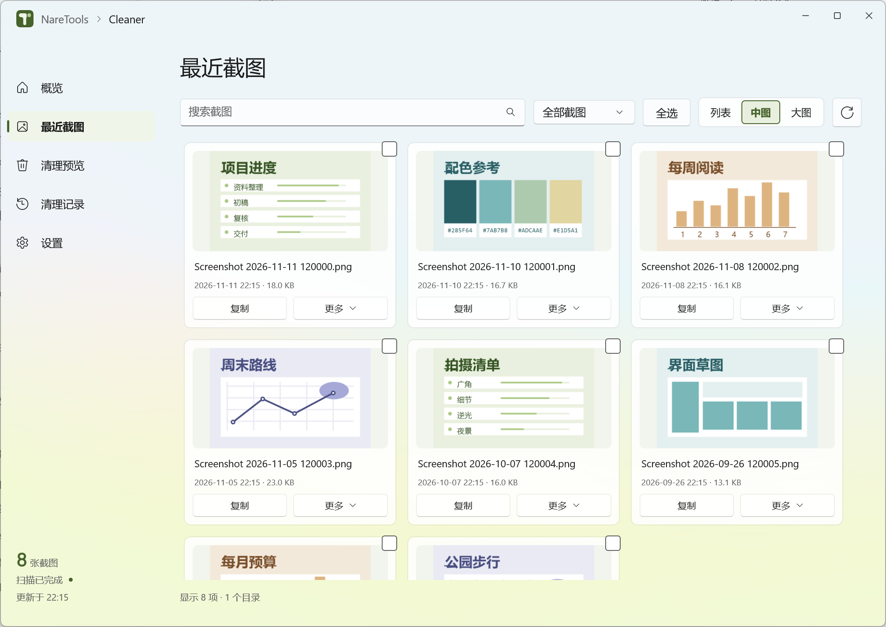
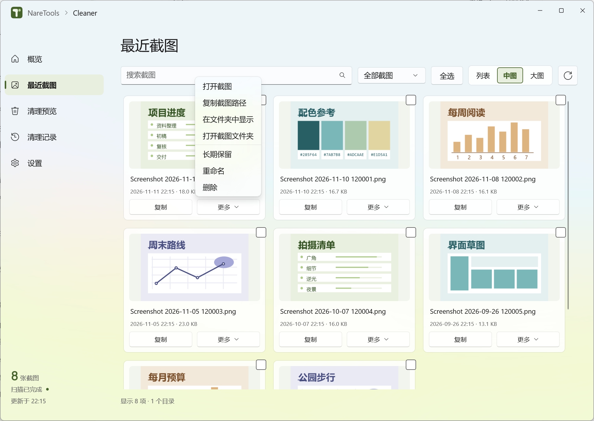
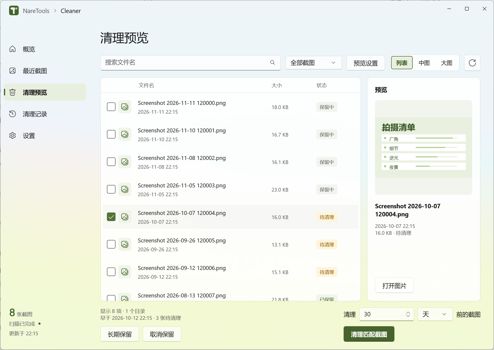
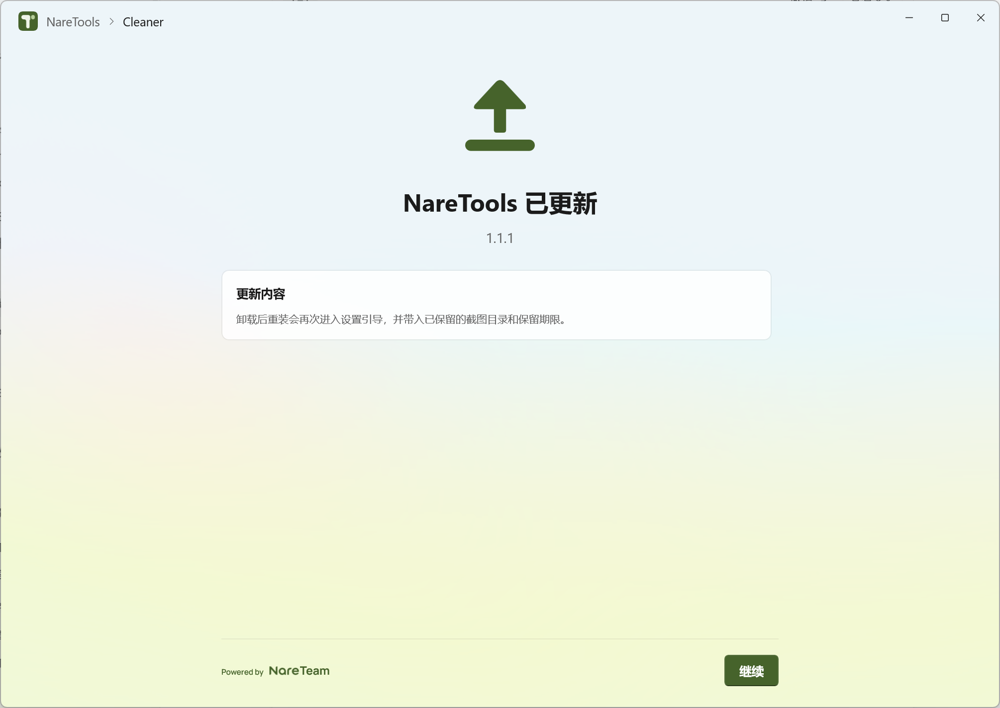

# NareTools

截图分散在多个文件夹时，可以在 **Cleaner** 里一起浏览。刚截的图可以直接复制或分享，想留的图可以标记为长期保留。积攒太多时，先预览哪些截图已过期，再把它们移入 Windows 回收站。

[下载 Windows x64 安装包](https://github.com/Retracar/NareTools/releases/latest) · [使用说明](Package/Windows/Cleaner/使用说明.md) · [更新记录](Package/Windows/Cleaner/CHANGELOG.md)

适用于 **Windows 11 22H2 及以上 x64**，安装包已包含运行库。

## 查看截图目录和保留期限

概览显示已管理的截图、待清理文件和当前保留期限。安装时会检测常见的 Windows 截图目录，也可以添加其他专用文件夹。

## 浏览和整理截图

在「最近截图」里用缩略图找图，也可以切换为列表。复制、分享、重命名和定位文件都从这里操作，支持多选。重要截图可以设为长期保留。

查看「更多」菜单

## 按时间清理

在「清理预览」选择几天、几周或几个月前的截图，核对文件和日期后再清理。清理时会显示进度，已移入回收站的截图可以从 Windows 回收站恢复。

需要定期整理时，可以在设置中开启自动清理。它由 Windows 按计划运行，仅在已登录且接通电源时执行。

## 安装、升级与重装

- **首次安装** · 选择安装位置和快捷方式，再确认截图目录及保留期限。自动清理默认关闭。
- **覆盖升级** · 直接运行新版安装包，已有设置会继续沿用。首次打开时查看更新内容，点击「继续」即可进入主界面。
- **卸载后重装** · 卸载时可以保留应用数据。重装时，引导会带入保留的截图目录和期限，供你重新确认。

界面截图来自 1.1.1 实窗，展示用图片为示例文件。截图在本机处理。
